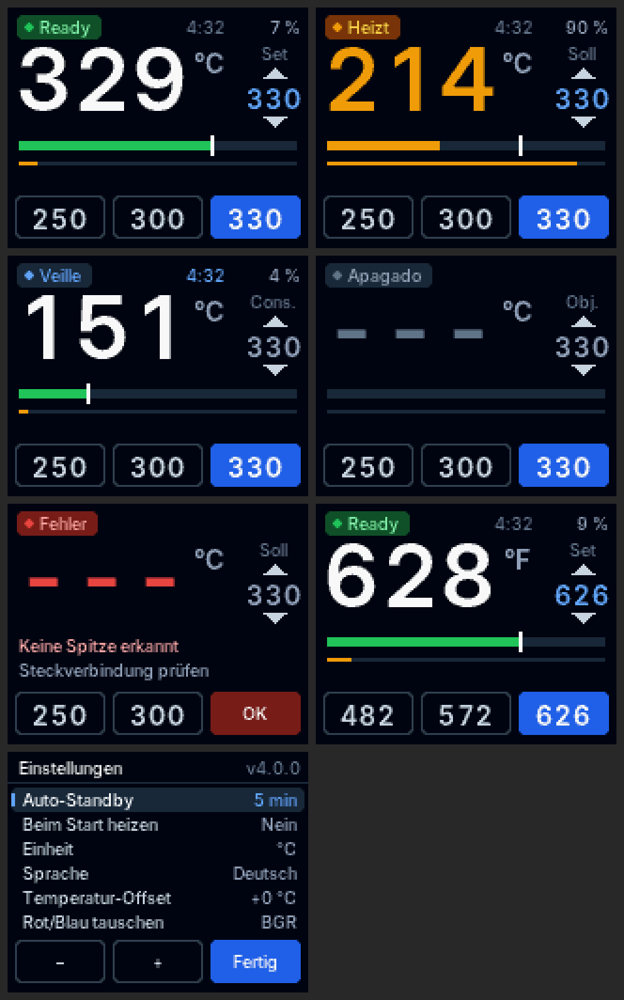

# Maiskolben THT – Firmware 4.x

Rewrite of the firmware for the **Maiskolben THT** soldering station
(board rev. 1.3c, Arduino Nano, 1.8" 128×160 SPI TFT, Weller RT tips),
based on the original Maiskolben v3.1 by Arduino Hannover / HannIO.



## What changed compared to v3.1

| Area | v3.1 | 4.x |
| --- | --- | --- |
| Temperature control | PID_v1, effectively P-only (sample time never set, I-term ≈ 0) → steady-state droop | PI with anti-windup, learned hold power, error diffusion for 1 ms resolution |
| Heater duty | 10 ms measurement pause every 20 ms → max. 50 % | 3 ms blanking every 40 ms → max. 90 %, roughly twice the power for heat-up and heavy joints |
| Timer interrupt | up to 10 blocking `analogRead()` calls, float PID and EEPROM writes inside a 1 kHz ISR | ISR only switches the heater; ADC is interrupt-driven; control and EEPROM run in `loop()` |
| Safety | – | ISR cuts the heater on open sensor, overtemperature (490 °C) or a stalled main loop |
| EEPROM | write on every degree while holding ▲/▼ | deferred write after 3 s idle, CRC-protected block, v3.1 data migrated read-only |
| Display | 5×7 system font scaled 2–3×, full redraws | anti-aliased Inter fonts, partial redraws only, Tailwind/Preline slate palette |
| Display driver | TFT_ILI9163C (2018) + Adafruit GFX | own ST7735S driver (~1 KB), no external libraries |
| Languages | English | English (US/UK), German, Spanish, French |
| Bugs fixed | standby timer mixed ms and s; unsigned underflow in countdown; options menu ran as LOW-level interrupt with `delay()`; boots into standby on blank EEPROM | |

The THT board has no voltage dividers on A2–A4 and no standby switch on A1,
so battery, USB-only and stand detection are not part of this firmware.
A missing supply shows up as "Not heating".

## Building and flashing

Requires [PlatformIO](https://platformio.org/) (CLI or VS Code extension).

```sh
pio run -t upload            # old Nano bootloader (most clones)
pio run -e nano_new -t upload  # new Optiboot bootloader
```

Flash: ~26.7 KB of 30 KB, RAM: ~540 B of 2 KB.

On first start the firmware reads presets, setpoint, °C/°F, display color
order and the ADC calibration from the v3.1 EEPROM area and stores them in
its own block (address 64+). The v3.1 area is never written, so flashing
the original firmware back works without losing settings.

## Operation

| Button | Short press | Long press (0.9 s) |
| --- | --- | --- |
| Power | Off → on, on ↔ standby, dismiss error | On → off; **off → settings** |
| ▲ / ▼ | ±1 degree (repeats when held, 5-degree steps after 2 s) | |
| T1–T3 | Recall preset | Store current setpoint to preset |

Hold Power during the splash screen to open the settings directly.

Settings (▲/▼ select, T1 –, T2 +, T3 done): auto standby (off, 1–30 min),
heat on power-up, unit, language, temperature offset (±30 °C), red/blue swap.

Auto standby drops to 150 °C after the configured idle time; a loaded tip
(temperature below setpoint) counts as activity. Wiping the tip on the
sponge in standby wakes it up. After 15 min in standby the station turns off.

## Tuning

All constants live in `src/config.h`.

* **Blanking time** (`CTRL_BLANK_MS`, default 3 ms): with the iron off, send
  `D` over the serial monitor. The station heats for 300 ms and prints the ADC
  settling curve after switch-off in 250 µs steps. Choose a blanking time
  safely after the values have settled.
* **PI gains** (`CTRL_KP`, `CTRL_KI`): the telemetry line (100 ms) contains
  setpoint, temperature and controller output and stays compatible with the
  original `Maiskolben_GUI`.

The heater now draws full current for up to 90 % of the time, so the power
supply must deliver the tip current continuously (12 V / ≥ 3.5 A for RT tips).

## Display troubleshooting

The driver targets ST7735S panels (blue "1.8 SPI TFT 128*160" boards). If the
image is rotated, shifted or inverted, enable the matching flag in
`platformio.ini`. Wrong colors can be fixed in the settings (red/blue swap).

## UI preview on the PC

`tools/sim` builds the real UI code against a frame buffer:

```sh
g++ -std=c++17 -DMAISKOLBEN_SIM -Itools/sim -Isrc \
    tools/sim/sim.cpp src/ui.cpp src/gfx.cpp src/i18n.cpp -o sim && ./sim
```

Fonts and palette are generated with `python3 -I tools/gen_fonts.py`
(Pillow and the Inter font family required).

## Enclosure

A 3D printable desk enclosure (OpenSCAD source and STL files) lives in
[`enclosure/`](enclosure/README.md).

## License and credits

GNU General Public License v2.0 or later, inherited from the original
Maiskolben firmware by Luca Zimmermann (Arduino Hannover / HannIO).
Glyph bitmaps are rendered from the Inter typeface by Rasmus Andersson
(SIL Open Font License 1.1).
