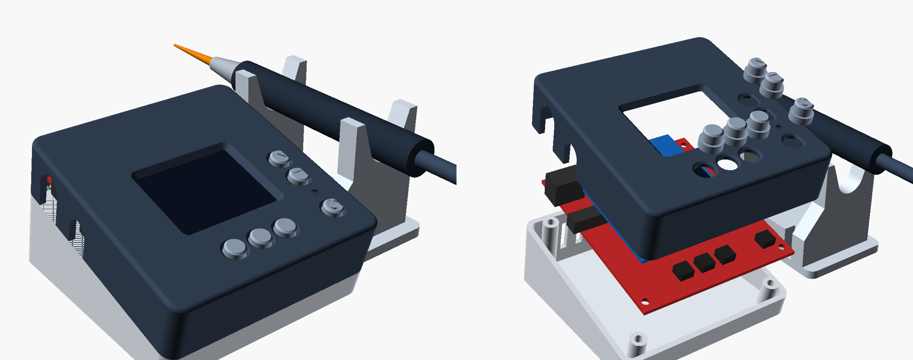

# Maiskolben THT – desk enclosure



Parametric OpenSCAD design for the Maiskolben THT board (rev. 1.3c),
dimensions taken from the original Eagle layout.

* **Lid** – frames the display with a 45° bezel, guides six button caps,
  bosses screw directly onto the PCB mounting holes.
* **Base** – 15° wedge so the display faces the user, vent slots at the back,
  hollow floor for ballast (a steel plate or washers keep the station from
  sliding when the iron cable pulls).
* **Caps** – T1–T3 plain, power, ▲ and ▼ with debossed symbols. The symbol
  caps have a D-flat that matches the lid holes, so they cannot rotate.
* **Iron holder** – bolts to the right side of the base and carries the
  handpiece by its grip in two U-shaped saddles. The tip points backwards
  into free air behind the station, so no hot part touches plastic.

Outside dimensions: 82 × 93 mm footprint, about 55 mm high at the back.

## Parts

| File | Orientation | Notes |
| --- | --- | --- |
| `stl/maiskolben_tht_lid.stl` | top face down | no supports |
| `stl/maiskolben_tht_base.stl` | as exported | no supports |
| `stl/maiskolben_tht_caps.stl` | flange down | 6 caps |
| `stl/maiskolben_tht_holder.stl` | as exported | no supports |
| `stl/maiskolben_tht_fitcheck.stl` | flat | 1.2 mm slice of the lid top |

PETG or ASA recommended, 0.2 mm layers, 3 perimeters, 20 % infill.

Hardware: 4 × M3×16 socket head screws (self-tapping into the lid bosses),
2 × M3×12 socket head screws and 2 × M3 nuts for the holder (the nuts sit in
pockets on the inside of the right base wall), 6 × self-adhesive rubber feet
up to 10 mm diameter (4 under the base, 2 under the holder).

## Before printing the lid

Print the **fit check** first (10 minutes): lay it on the assembled board and
verify that the display window and the six button holes line up. The values
to adjust are at the top of the `.scad` file:

* `display_center` – active area center in board coordinates
* `inner_h` – free height under the lid (default 15 mm, enough for a Nano on
  female headers including the USB socket)
* `button_top_z` – tactile plunger height (13 mm switches, measured)
* `dc_jack`, `tip_jack` – notch position, width and height for the jacks
* `iron_d` – grip diameter of your handpiece (default 14 mm; the flared
  saddles also take thinner grips), `holder_saddles` – where the grip rests

The design assumes the LM7805 is not fitted (12 V supply, SJ1 bridged).

## Assembly

1. Insert the caps into the lid from below.
2. Place the board on the lid (display side down) so the bosses meet the
   mounting holes.
3. Put the base on top, screw everything together from below.

USB is only reachable with the lid removed.

## Export

```sh
openscad -D 'part="lid"' -o lid.stl maiskolben_tht_case.scad
```

Parts: `assembly`, `exploded`, `lid`, `base`, `caps`, `fitcheck`.
